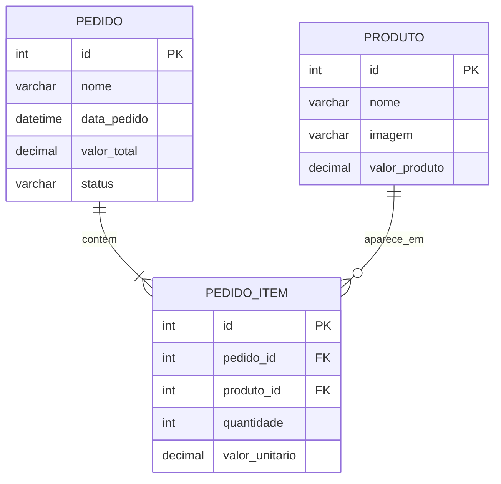

# LojaInfoWeb

<div align="center">

**Projeto acadêmico de configuração e implantação de uma aplicação empresarial em servidores Linux.**

[](https://www.debian.org/)
[](https://httpd.apache.org/)
[](https://www.php.net/)
[](https://www.mysql.com/)
[](https://mariadb.org/)
[](https://developer.mozilla.org/docs/Web/HTML)
[](https://developer.mozilla.org/docs/Web/CSS)
[](https://getbootstrap.com/)
[](https://git-scm.com/)
[](https://github.com/)

</div>

Uma aplicação de loja virtual com frontend, painel administrativo e banco de dados independente, desenvolvida e preparada para implantação em ambiente Linux.

---

## Arquitetura

O projeto pode ser executado em um servidor local com Apache2, PHP e MySQL/MariaDB ou publicado em hospedagem compartilhada InfinityFree.

```text
Máquina cliente
      │ navegador
      ▼
Servidor Web — Apache2 + PHP
      ├── /                 Frontend da loja
      ├── /admin/            Painel administrativo
      └── /config/           Configurações locais da aplicação
                    │
                    ▼
Servidor de Banco de Dados
         MySQL/MariaDB
                    │
                    ▼
                 loja_db
```

| Componente | Função |
| --- | --- |
| **Frontend** | Exibe produtos, carrinho e interface para criação de pedidos. |
| **Backend** | Disponibiliza autenticação, CRUD de produtos e gerenciamento de pedidos em `/admin/`. |
| **Banco de dados** | Armazena produtos, pedidos e itens dos pedidos em MySQL/MariaDB. |

---

## Diagrama ER

O banco utilizado pela aplicação possui duas entidades obrigatórias relacionadas:

- `Produto`
- `Pedido`

A entidade `PedidoItem` representa os itens presentes em cada pedido.



O diagrama completo está disponível em [`confs-mysql/DER.md`](confs-mysql/DER.md).

---

## Funcionalidades

- Visualização de produtos no frontend;
- Controle de carrinho e criação de pedidos;
- Autenticação administrativa;
- Cadastro, edição e exclusão de produtos;
- Consulta e atualização de status dos pedidos;
- Exclusão de pedidos;
- Comunicação entre frontend, painel administrativo e banco de dados.

---

## Estrutura do projeto

```text
LojaInfoWeb
├── confs-apache2/
│   ├── frontend.conf
│   └── backend.conf
├── confs-mysql/
│   ├── DER.md
│   ├── schema.sql
│   ├── migracao-loja.sql
│   └── migracao-carrinho.sql
├── site-frontend/
│   ├── index.php
│   ├── db.php
│   └── store.css
├── site-backend/
│   ├── db.php
│   ├── admin/
│   │   ├── index.php
│   │   ├── image-path.php
│   │   └── views/
│   └── assets/
│       └── css/
├── config/
│   ├── database.example.php
│   ├── admin.example.php
│   ├── database.local.php
│   └── admin.local.php
├── SUBIR_INFINITY/
│   ├── config/
│   │   ├── database.local.php
│   │   └── admin.local.php
│   ├── admin/
│   ├── assets/
│   ├── index.php
│   ├── db.php
│   └── store.css
├── apresentacoes/
└── README.md
```

---

## Configuração

Arquivos com dados sensíveis locais não devem ser compartilhados publicamente.

- `config/database.example.php`: modelo da configuração do banco;
- `config/admin.example.php`: modelo da configuração administrativa;
- `config/database.local.php`: credenciais locais ou de produção do banco;
- `config/admin.local.php`: credenciais locais ou de produção do painel;
- Variáveis de ambiente `DB_HOST`, `DB_NAME`, `DB_USER` e `DB_PASSWORD` podem sobrescrever a configuração do banco.

Os scripts SQL necessários estão em [`confs-mysql/`](confs-mysql/). Antes da implantação, importe `schema.sql` e confirme as migrações necessárias ao recurso utilizado.

---

## Implantação no InfinityFree

A pasta [`SUBIR_INFINITY/`](SUBIR_INFINITY/) contém uma cópia pronta para envio ao diretório `htdocs/` da hospedagem.

A estrutura publicada deve ficar semelhante a:

```text
htdocs/
├── config/
│   ├── database.local.php
│   └── admin.local.php
├── admin/
├── assets/
├── index.php
├── db.php
└── store.css
```

Para publicar:

1. Faça upload do conteúdo de `SUBIR_INFINITY/` para o `htdocs/` da hospedagem;
2. Importe o banco de dados pelo phpMyAdmin;
3. Ajuste `config/database.local.php` com os dados fornecidos pela hospedagem;
4. Acesse o frontend pela URL principal;
5. Acesse o painel administrativo por `/admin/`.

O link do painel no frontend já direciona para `/admin/`, mantendo frontend e backend no mesmo domínio hospedado.

---

## Executando localmente

```bash
git clone <URL_DO_REPOSITORIO>
cd ICS-LINUX
```

Configure um VirtualHost ou copie os diretórios necessários para o servidor Apache. Para uma execução simplificada em ambiente Linux:

- Configure Apache2 e PHP;
- Configure MySQL/MariaDB;
- Crie o banco `loja_db` usando os scripts SQL;
- Ajuste `config/database.local.php`;
- Ajuste `config/admin.local.php`;
- Reinicie Apache2 e MySQL/MariaDB;
- Acesse o frontend e o painel administrativo pelas URLs configuradas no Apache.

---

## Artefatos do projeto

| Diretório | Descrição |
| --- | --- |
| [`confs-apache2/`](confs-apache2/) | Configurações Apache2 dos sites frontend e backend. |
| [`confs-mysql/`](confs-mysql/) | Diagrama ER e scripts SQL do banco. |
| [`site-frontend/`](site-frontend/) | Arquivos da aplicação acessada pelo usuário final. |
| [`site-backend/`](site-backend/) | Arquivos da aplicação administrativa. |
| [`SUBIR_INFINITY/`](SUBIR_INFINITY/) | Pacote preparado para upload no `htdocs/`. |
| [`apresentacoes/`](apresentacoes/) | Materiais e imagens da apresentação. |

---

<div align="center">

**LojaInfoWeb**

*Projeto acadêmico — Infraestrutura, servidores Linux e desenvolvimento Web.*

</div>