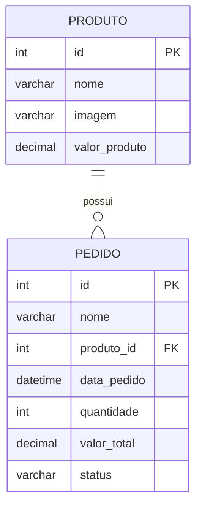

# Diagrama Entidade-Relacionamento — LojaInfoWeb

## Relacionamento

Um produto pode estar associado a vários pedidos.
Cada pedido referencia um produto por meio de `produto_id`,
que aponta para `Produto.id`.

O campo `imagem` guarda a URL ou o caminho da imagem do produto. Novos pedidos recebem data e hora atuais e começam com o status `Pendente`.
