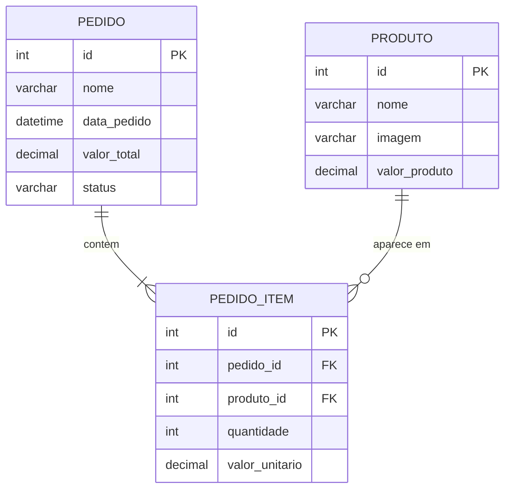

# Diagrama Entidade-Relacionamento — LojaInfoWeb

## Relacionamento

Um pedido contem um ou mais itens. Cada item referencia um produto e guarda
a quantidade e o preco unitario no momento da compra.

O campo `imagem` guarda a URL ou o caminho da imagem do produto. Novos pedidos recebem data e hora atuais e começam com o status `Pendente`.
